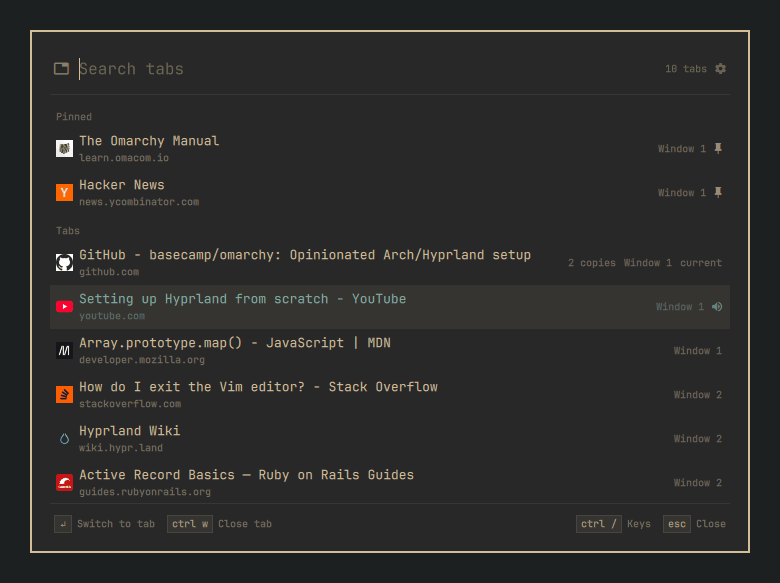
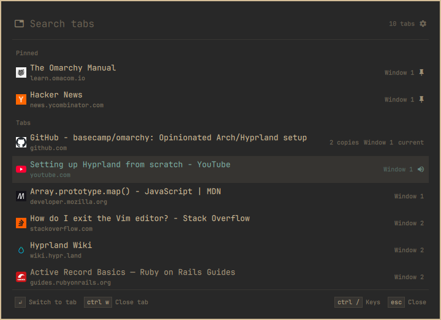
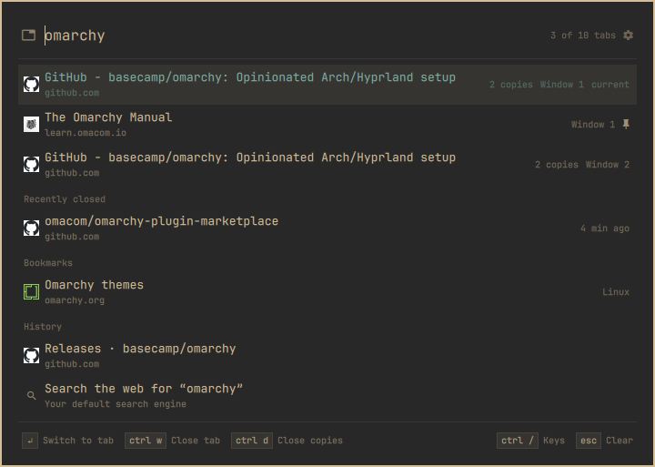
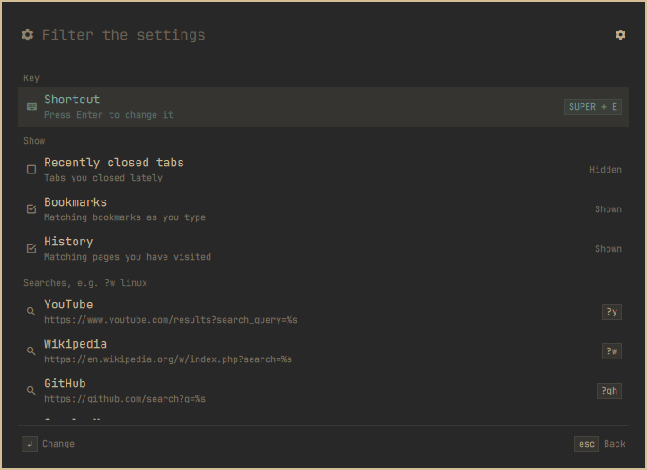

# Browser Tab Search



Find any open browser tab from anywhere in Omarchy. Press `SUPER + E`, type a few letters of the title or the address, and press Enter: the browser comes to the front on that tab, even if it sits on another workspace. It also lists the tabs you closed recently, and as you type it searches your bookmarks and history too.

Works with Chromium-based browsers. Tested with Brave Origin and Chromium. Brave, Vivaldi and Edge should work as well, but have not been tested. Google Chrome does not work: since version 137 it ignores the `--load-extension` start-up flag, which this plugin uses to load its extension. Firefox and Zen are not supported.


## Install

```sh
omarchy plugin add https://github.com/MaNi4/omarchy-browser-tab-search --enable
```

Open it with `SUPER + E`, choose **Connect Brave Origin to Browser Tab Search** (or whichever browser you use), then quit the browser completely and start it again. This installs a small helper and adds the plugin's extension to your browser's start-up flags, next to the extensions Omarchy already loads there.

## Remove

```sh
~/.config/omarchy/plugins/mani4.browser-tab-search/bin/browser-tab-search disconnect
omarchy plugin remove mani4.browser-tab-search
```

`disconnect` removes the extension from the start-up flags and unregisters the helper. Restart the browser afterwards.

### What it changes outside its folder

- **Connect** adds `--load-extension=<plugin>/extension/chromium` to your browser's flags file (`~/.config/brave-origin-flags.conf`, `chromium-flags.conf`, …) and leaves every other line alone. It also writes `com.mani4.tab_search.json` into the browser's `NativeMessagingHosts` folder. Nothing else in your browser profile is touched, and `disconnect` undoes both.
- The shortcut is bound through `hyprctl` while the plugin runs. Your Hyprland config is not edited, and disabling the plugin removes the binding.
- Settings are saved in `~/.config/omarchy/extensions/browser-tab-search.json`, readable only by you.
- While a browser is running, its helper keeps a socket in `$XDG_RUNTIME_DIR/browser-tab-search/`. It goes away when the browser quits.

## Usage

| Key | Action |
| --- | --- |
| `SUPER + E` | Open or close the launcher |
| type | Filter by title, site or address. Accents don't matter: `cafe` finds *Café* |
| `↑` `↓`, `Ctrl + N/P`, `Ctrl + J/K` | Move up and down |
| `Page Up` `Page Down` | Move a page at a time |
| `Enter` | Switch to the tab, or open the selected item |
| `Tab`, `Shift + Tab` | Mark or unmark, then go to the next one (like fzf) |
| `Ctrl + A` | Mark all listed tabs; press again to unmark |
| `Ctrl + W` | Close the tab, or all marked tabs |
| `Ctrl + D` | Close the other copies of this page |
| `Ctrl + M` | Mute or unmute |
| `Ctrl + Shift + P` | Pin or unpin |
| `Shift + ↑` `Shift + ↓` | Move a pinned tab, in the browser too |
| `Ctrl + C` | Copy the address |
| `Ctrl + Shift + T` | Reopen the last closed tab |
| `Ctrl + ,` | Settings (or click the gear) |
| `Ctrl + /` | Show all keys |
| `Esc` | Go back, unmark, clear the search, or close |

`Ctrl + W`, `Ctrl + M` and `Ctrl + Shift + P` act on all marked tabs when some are marked.

### What you see

With nothing typed, your pinned tabs come first, in the same order as in the browser. All other tabs follow, most recently used first. The tab you used before the current one is already selected, so `SUPER + E` and `Enter` flip between your last two tabs.

Below the tabs:

- **Recently closed** shows the last five tabs or windows you closed. Enter reopens one. `Ctrl + W` hides it from this list (the browser keeps its own copy, which extensions can't change).
- **Bookmarks** and **History** appear once you start typing, up to eight of each. Pages that are already open are left out.

If you type an address like `example.org` or `localhost:3000`, the first row offers to open it in a new tab. The last row always offers a web search for what you typed.

Each row shows the site's icon, the title and the site. On the right you'll see the window number (if you have several windows), **2 copies** for pages open more than once, and icons for tabs that are playing sound, muted or pinned. Sleeping tabs are dimmed.

### Filters

Start a word with `!` to show only certain tabs. The first letter is enough, and you can add normal search words: `!a youtube`.

| Filter | Shows |
| --- | --- |
| `!a`, `!audio` | tabs playing sound |
| `!m`, `!muted` | muted tabs |
| `!p`, `!pin` | pinned tabs |
| `!d`, `!dup` | pages open more than once |

To clean up duplicates in one go: type `!d`, press `Ctrl + A`, unmark the ones you want to keep with `Tab`, then press `Ctrl + W`.

### Searching the web

Start with `?` to skip the tabs and search right away:

| Type | Searches |
| --- | --- |
| `?rust book` | the web, with your browser's default search engine |
| `?w linux` | Wikipedia |

These site shortcuts are included: `?y` YouTube, `?w` Wikipedia, `?gh` GitHub, `?m` Google Maps, `?r` Reddit, `?x` X, `?a` Amazon. You can change them in the settings.

### Settings

Press `Ctrl + ,` or click the gear next to the search field. Type to filter, press Enter to change the selected item, Esc to go back.

- **Shortcut**: the key that opens the launcher. Enter shows a list of free keys, and taken ones say what uses them. You can also type your own, such as `SUPER + ALT + T`. If your shortcut is taken when Browser Tab Search starts, you get a notification; click it to pick another one.
- **Show**: turn Recently closed, Bookmarks or History on or off.
- **Searches**: press Enter on a search to edit its shortcut, name and URL. In the URL, `%s` marks where the search words go, for example `https://stackoverflow.com/search?q=%s`. **Add a search** creates a new one, `Ctrl + W` twice removes one, and **Restore the default searches** brings back the list above.

Everything is saved in `~/.config/omarchy/extensions/browser-tab-search.json`:

```json
{
  "hotkey": "SUPER + E",
  "show": { "closed": true, "bookmarks": true, "history": false },
  "searches": [
    { "key": "y", "name": "YouTube", "url": "https://www.youtube.com/results?search_query=%s" }
  ]
}
```

Set `"hotkey"` to `""` to bind no key; you can still open it with `omarchy-shell shell toggle mani4.browser-tab-search '{}'`.

### More than one browser

Tabs from all connected browsers are listed together. If you run two copies of the same browser with different profiles, they are labelled by profile folder, for example `Chromium (work)`. New tabs and web searches open in the browser you used last.

## Troubleshooting

**No tabs show up after connecting.** The browser has to be fully restarted, not just its window closed. Quit it completely, including any web apps it runs, and start it again. Browser Tab Search tells you when a browser is still running from before.

**"Turn on developer mode to use this extension".** This shows up after pressing the extension's reload button in `brave://extensions`: the browser then treats it as an unpacked extension of yours rather than one loaded at start-up. Quit the browser completely and start it again, and it is loaded the normal way.

**Still no tabs.** In `brave://extensions` (or `chrome://extensions`), look for **Errors** under Omarchy Browser Tab Search; they say what went wrong. Don't press reload there.

**Disconnected by mistake, or the plugin folder moved.** Choose **Connect** in Browser Tab Search again and restart the browser.

**The shortcut does nothing.** Something else may use it. Open the settings with `omarchy-shell shell summon mani4.browser-tab-search '{"mode": "hotkey"}'` and pick a free one.

## Screenshots

| Your tabs | Searching | Settings |
| --- | --- | --- |
|  |  |  |

## How it works

Nothing outside the browser can talk to a browser extension directly, so the plugin has three parts:

- **The extension** (`extension/chromium/`, Manifest V3) reads your tabs, recently closed tabs, bookmarks and history, and switches, closes, pins, moves, reopens or opens tabs on request. It makes no network requests of its own. It needs the `tabs`, `nativeMessaging`, `favicon`, `alarms`, `bookmarks`, `history`, `sessions` and `search` permissions.
- **The helper** (`bin/browser-tab-search`) is started by the browser and runs as long as the browser does. It passes requests from the launcher to the extension over a Unix socket in `$XDG_RUNTIME_DIR/browser-tab-search/`. The folder and socket are private to your user, the helper checks who connects, and it talks to no other extension.
- **The launcher** runs the same `bin/browser-tab-search` to list tabs (`list`), switch to one and focus its window (`activate`), act on tabs (`tabs`, `move`, `dedupe`, `restore`, `open`), search bookmarks and history (`serve`), open searches and addresses (`web`) and save settings (`save-config`).

What you type, page titles and addresses are never passed as command-line arguments, where other programs could see them. They go through stdin instead. Only tab ids, session ids and socket names appear as arguments.

The launcher's code:

- `BrowserTabSearch.qml` holds the state, runs `bin/browser-tab-search` and handles keys. It uses the colours of Omarchy's menu, so it follows your theme.
- `Model.js` decides which tabs match and in what order.
- `Views.js` decides what the rest of the launcher says: the key list, settings, footer hints and row details.
- `ui/` contains the parts it is drawn from: rows, the footer and the search editor.
- `Service.qml` and `Hotkey.js` bind the shortcut.

The text fields never read the clipboard by themselves. `Ctrl + V` reads only the first kilobyte, and only when you press it.

## Requirements

- Omarchy with omarchy-shell
- A Chromium-based browser: Brave Origin or Chromium (tested), Brave, Vivaldi or Edge (untested); not Google Chrome
- Python 3
- wl-clipboard

Firefox, Zen and Google Chrome are not supported.

## Tests

```sh
node tests/run.js
python3 -m unittest discover -s tests
```

The first covers `Model.js`, `Views.js` and `Hotkey.js` and checks the QML files. The second covers `bin/browser-tab-search` and the extension files.

If you change the extension's `worker-N.js`, rename it to the next number and update `tests/workers.json`. Browsers keep running a cached copy of an unpacked extension unless the file name changes, and the tests fail as a reminder.

## License

MIT
